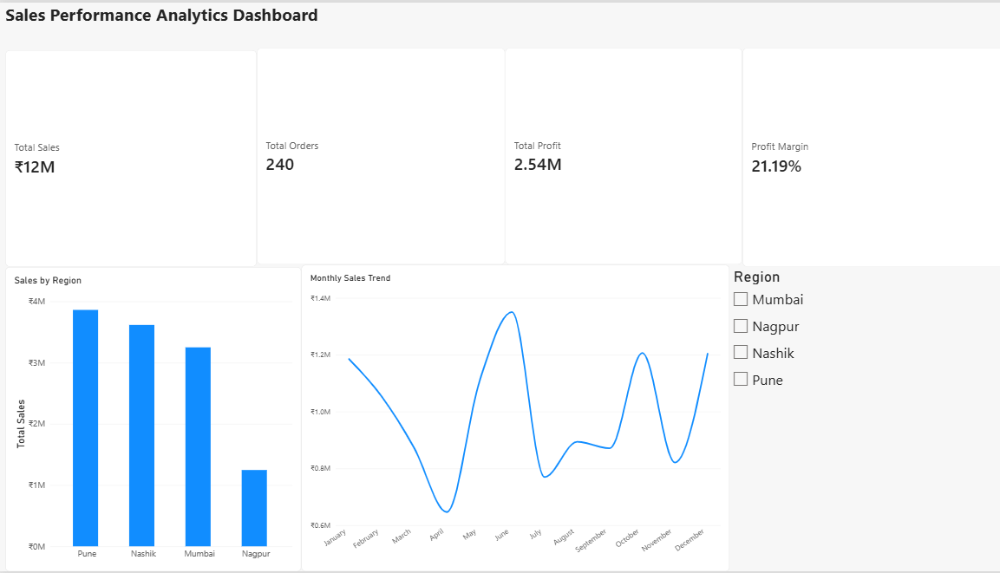

Sales Performance Analytics

Project Overview

This project analyses sales performance to understand revenue, profitability, order volume and regional business performance using Power BI.

Business Objectives

- Analyse overall sales and profit performance.
- Monitor important business KPIs.
- Compare sales performance across regions.
- Identify trends and support data-driven business decisions.

Tools & Technologies

- Power BI
- DAX
- Data Modelling
- Data Visualisation

Key Performance Indicators (KPIs)

- Total Sales
- Total Orders
- Total Profit
- Profit Margin

Dashboard Results

| KPI | Result |
|---|---:|
| Total Sales | ₹1,19,78,800 |
| Total Orders | 240 |
| Total Profit | ₹25,38,050 |
| Profit Margin | 21.19% |

Regional Analysis – Mumbai

| KPI | Result |
|---|---:|
| Orders | 62 |
| Sales | ₹30,00,000 |
| Profit | ₹7,06,300 |
| Profit Margin | 21.72% |

Key Findings

- Overall profit margin was 21.19%.
- Mumbai contributed ₹30 lakh in sales.
- Mumbai recorded a profit margin of 21.72%.
- Regional filtering helps compare business performance.

Project Outcome

Created an interactive sales analytics dashboard to monitor business KPIs, evaluate profitability and analyse regional sales performance.

Author

Amol Borse

Note

This is a portfolio project demonstrating practical data analytics and business intelligence skills.
